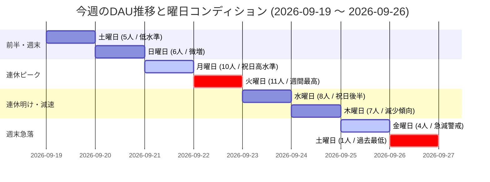

# 📊 週次アナリティクス分析レポート (Weekly Analytics Report)

**集計期間**: 2026-09-19 〜 2026-09-26  
**作成日時**: 2026-09-27 (更新: 2026-10-26)  
**作成者**: renn / yusuke  

---

## 🎯 1. ハイライト & サマリー (KPI Dashboard)

今週のアプリ全体の主要パフォーマンス指標（KPI: 重要業績評価指標。アプリの成長目標を測るための数値）のサマリーです。

*   **今週の平均DAU**: **6.5 人**（全8日間平均: `6.5人` / 直近7日間平均: `6.7人`）
    *   *前週水準（8.0人〜9.5人）と比較して **約18.8%減少**。週後半の失速が平均を大きく引き下げました ⚠️*
*   **週内最高DAU（ピーク）**: **11 人**（2026-09-22 火曜日・国民の休日 / 連休中の利用促進およびv3.3.0新機能が奏功 🟢）
*   **週内最低DAU（ボトム）**: **1 人**（2026-09-26 土曜日 / 過去最低水準を記録。緊急の状況確認が必要 🚨）
*   **平日 vs 週末比**: 平日（月〜金）平均 **8.0 人** に対し、週末（土・日）平均 **4.0 人**（週末の利用が平日の半分に落ち込み、特に土曜日の離脱が深刻）

---

## 🔄 2. 前週アクションプランの成果検証 (Previous Act Review)

前週設定したアクションプランに対する実行結果と数値の検証結果です。

| 施策名・概要 | 期待していた効果 | 実行結果 (数値・実績) | 評価・今後の対応 |
| :--- | :--- | :--- | :--- |
| **施策A: 土曜日朝の「週末スタート・リフレッシュ通知」配信** | 週末土曜日のDAUを 6人 → 10人以上へ改善 | 9/19(土): **5人**、9/26(土): **1人** に急落 | 🔴 **未達・要緊急調査**: 土曜の起動が定着せず、特に9/26は1人まで急落。通知文面の改善だけでなく、FCM（プッシュ通知機能）の配信不達障害がないか緊急調査 |
| **施策B: ダイレクトチャット & ペアストリーク強化（v3.3.0）** | 平日平均DAUを 9.8人 → 11.5人以上へ引き上げ | 連休前半（9/21〜9/22）は **10〜11人** と好調だったが、連休明け後半に失速し平日平均 **8.0人** | 🟡 **一部効果あり・後半失速**: 連休中は活発に使われたが、連休明けにタスク忘れが発生。ストリークが途切れた後の再開を支える仕組みが必要 |

---

## 📈 3. DAU & 主要メトリクス詳細 (Metrics Breakdown)

### 📊 今週のDAU推移と曜日コンディション

### 📋 日別全アナリティクスデータ

*(参照元: [analytics_data.csv](file:///Users/rennlikeu/development/V-Effect/docs/analytics/analytics_data.csv))*

| 日付 | 曜日 | DAU (人) | 状態・コンディション | 特記事項・傾向 |
| :--- | :--- | :---: | :---: | :--- |
| 2026-09-19 | 土 | 5 | ⚠️ 低迷 | 週末初動の利用離脱が継続。前週水準と同等 |
| 2026-09-20 | 日 | 6 | ⚪️ やや低調 | 日曜も前月（11人）に比べ大幅に低下 |
| 2026-09-21 | 月・祝 | 10 | 🟢 好調 | 敬老の日。連休初日でアクティブ数二桁回復 |
| 2026-09-22 | 火・祝 | **11** | 🟢 **最高** | **国民の休日。v3.3.0新機能（ペアストリーク・応援）の利用が寄与** |
| 2026-09-23 | 水・祝 | 8 | ⚪️ 平常 | 秋分の日。連休最終日にかけて徐々に落ち着く |
| 2026-09-24 | 木 | 7 | 🟡 減速 | 連休明けの通常平日。中だるみ・減少が始まる |
| 2026-09-25 | 金 | 4 | 🔴 **急減** | **平日としては異例の低水準。週末前の離脱が加速** |
| 2026-09-26 | 土 | **1** | 🚨 **危険水準** | **週間最低・過去最低を記録。通知不達やクラッシュの可能性を含め緊急検証が必要** |

---

## 🔍 4. 今週のトレンド分析と課題 (Check)

### 1. 良好な傾向 (Good Points)
* **連休前半（9/21〜9/22）の高いエンゲージメント（DAU 10〜11人）**:
  * 敬老の日および国民の休日の連休中、月曜に10人、火曜に今週最多の11人を記録しました。
  * v3.3.0で追加されたダイレクトチャットのスマート応援機能やペアストリーク（相棒と一緒に連続記録を伸ばす機能）が、連休中の仲間同士の交流を後押ししました。

### 2. 改善が必要な深刻な課題 (Bottlenecks)
* **連休明け後半（9/24木〜9/26土）の雪崩的な急落**:
  * 木曜7人 → 金曜4人 → 土曜1人と、日を追うごとに半減に近いペースで落ち込みました。
  * 連休が明けて仕事や学校が再開したことで生活リズムが崩れ、タスクを行うタイミングを逃す「連休明けの習慣断絶（リバウンド離脱: 休み明けに習慣が途切れてしまうこと）」が発生したと考えられます。
* **土曜 9/26 の DAU 1人（過去最低記録）**:
  * 土曜日のアクティブ数がわずか1人まで急落しました。通常の週末離脱だけでなく、**「プッシュ通知が正しく配信されなかった」「特定端末でアプリクラッシュが発生した」などのシステム的障害の可能性** も疑われます。
* **週末平均DAUの著しい低迷（4.0人）**:
  * 平日平均8.0人に対して週末平均は4.0人と半減しており、平日に形成された利用習慣が週末に途切れてしまっています。

---

## 💡 5. 今週のアクションプラン (Next Act & Hypotheses)

### 施策A: 【緊急】9/26急落（DAU 1人）のシステムヘルスチェック & 通知配信ログ調査 🚨
* **背景・課題仮説**: 単なるユーザーの習慣忘れだけでなく、FirebaseのFCM（プッシュ通知機能: スマホに通知を送るGoogleの仕組み）、Cloud Functionsのエラー、またはアプリの特定バージョンでのクラッシュ等によりユーザーがアプリを開けなかった可能性を検証する。
* **具体的内容**:
  * Firebase ConsoleおよびCloud Functionsログにて、`sendPushNotification` 等の実行エラーやタイムアウトが発生していないか確認。
  * FCMプッシュ通知の配信成功率・到達状況をチェック。
  * テスト端末にて最新ビルドの起動確認および通知受信テストを実施。
* **目標KPI**: システム起因の問題の有無を **100%特定** し、不具合があれば即時修正。
* **担当・期限**: yusuke (ログ・システム調査) & renn / 2026-09-28（月）中。
* **検証方法**: Firebaseログの精査結果および動作確認レポートを作成。

### 施策B: 連休明け・週末の挫折を防ぐ「ストリークリカバリー（救済）リマインダー」配信 🔔
* **背景・課題仮説**: 1日タスクをサボると「ストリーク（連続日数: 毎日休まず投稿を続けた日数）が切れてしまったからもういいや」と諦めてアプリを開かなくなる心理（どうにでもなれ効果）が離脱の主因。救済や再開を優しく促す通知を送ることで復帰率を高める。
* **具体的内容**:
  * 未投稿のユーザーに対し、土曜・日曜の夜（20:00）に「昨日の記録が途切れても大丈夫！今日からまた再開して仲間とストリークをつなげよう🔥」という励まし通知を配信。
  * 土曜朝（10:30）に「休日のスキマ時間にサクッと1分、自分磨きをパシャリ📸」という気軽なリマインダーを配信。
* **目標KPI**: 次週の週末（土日）DAUを **平均 7人以上**（前週4.0人からの回復）へ引き上げ。
* **担当・期限**: renn (通知文面作成・FCMスケジュール設定) / 2026-10-02（金）まで。
* **検証方法**: 次回レポートの土曜・日曜のDAU推移で効果判定。

### 施策C: ペア機能連動の「相棒ピンチ！チアアップ応援」通知の導入 🤝
* **背景・課題仮説**: 個人だけの力では継続が難しい週末や連休明けに、ペアを組んでいる相棒からの一押し（ソーシャルリテンション: 人との繋がりや励まし合いによってアプリを継続すること）によってアプリ起動を促す。
* **具体的内容**:
  * 夕方時点で片方が未達成の場合、もう片方のパートナーに「〇〇さんが今日のタスクにまだ挑戦していません！スタンプでエールを送ろう💪」と通知し、チャットからのスマート応援送信を促進。
* **目標KPI**: 週後半（木・金）のDAUを **8人以上** に維持。
* **担当・期限**: renn (UI・通知文面) & yusuke (ロジック実装) / 次期スプリントにて設計・実装。
* **検証方法**: チャットからの応援スタンプ送信数および通知経由の起動率で検証。

---
*本レポートは V EFFECT プロジェクトのアナリティクスデータ ([analytics_data.csv](file:///Users/rennlikeu/development/V-Effect/docs/analytics/analytics_data.csv)) に基づいて更新・生成されました。*
